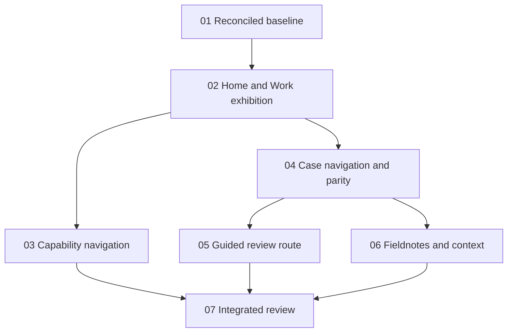

# Portfolio integration ticket review

Decision requested: approve the proposed seven-slice decomposition and dependency graph of [#32](https://github.com/athan-dial/athan-dial.github.io/issues/32). The author delegated planning and decomposition and requested ticketing. This is the pre-publication review package, not a second tracker. Human approval and independent certification are still required; no native child issues or activation are claimed.

Parent normative digest: `b9402b81fb1cfa5f889008a608a40632e9590fbcb16334ff6881d62b833a60b4`

## Dependency graph

| Draft ID | Slice | Direct blockers | Carries |
|---|---|---|---|
| [01](issues/01-reconciled-baseline.md) | Establish the verified integration baseline | None | R7, C1, C2, C3, C4, C5 |
| [02](issues/02-selected-work-tracer.md) | Deliver the homepage and curated Work exhibition | 01 | R1, R2, C1, C2, C3, C4, C5 |
| [03](issues/03-capability-navigation.md) | Connect capabilities to inspectable work | 02 | R3, C1, C2, C3, C4, C5 |
| [04](issues/04-case-navigation-and-parity.md) | Unify case orientation while preserving each mechanism | 02 | R5, C1, C2, C3, C4, C5 |
| [05](issues/05-guided-review-route.md) | Provide the complete local guided walkthrough | 04 | R4, C1, C2, C3, C4, C5 |
| [06](issues/06-fieldnotes-proof-context.md) | Connect the intellectual and professional context | 04 | R6, C1, C2, C3, C4, C5 |
| [07](issues/07-integrated-review-and-safety.md) | Verify the complete integrated portfolio and production boundary | 03, 05, 06 | R1, R2, R3, R4, R5, R6, R7, R8, C1, C2, C3, C4, C5 |

01 establishes a verifiable baseline and manifest without requiring absent implementations. 02 delivers the working editorial entry point and eligibility seam. 03 and 04 can proceed independently; 05 and 06 rely on 04's actual anchors and conventions. 07 is the integration review and carries all original parent requirements. The final review has external prerequisites: completion, approval and current verification of the three other case-study packages, existing work-product and compatible workflow-atlas implementation. These are not assumed finished or duplicated in the integration scope.

Review the graph and exact draft contracts through agent-home human-review. Do not activate or publish tracker children until the required gate is recorded. Once approved, create seven proposed native GitHub child issues in dependency order, substitute actual blocker issue URLs, link them to #32 and certify each current digest independently. Preserve the parent body and existing release authority. The canonical tracker remains GitHub Issues; this branch is for review only, never the implementation queue.
