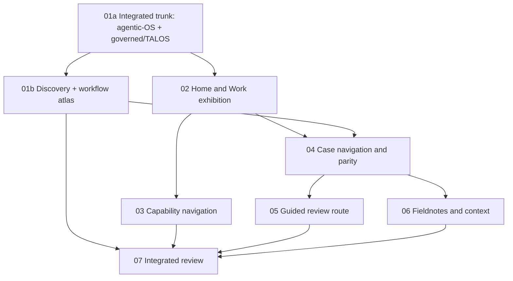

# Portfolio integration ticket review (revised, local draft)

Parent normative digest: `b9402b81fb1cfa5f889008a608a40632e9590fbcb16334ff6881d62b833a60b4`

Parent: #32 (text and normative digest b9402b81fb1cfa5f889008a608a40632e9590fbcb16334ff6881d62b833a60b4 unchanged).
Source: review/portfolio-integration-tickets drafts 01-07, revised by the decisions on this wayfinder map. Publishing to the review branch, human review and Steward certification are separate gated steps.

| ID | Slice | Direct blockers | Change from draft |
|---|---|---|---|
| 01a | Integrated trunk (agentic-OS branch as base; replay governed+TALOS's 25 commits) | none | Replaces draft 01. Carries R7, C1-C5 |
| 01b | Add discovery (plain merge) and workflow atlas (replay, rebuild atlas.js) | 01a | New. Carries R7, C1-C5 |
| 02 | Home and curated Work exhibition | 01a | Blocker 01 becomes 01a; Locked adds Work index base, exhibit_order, local-review flag |
| 03 | Capability navigation | 02 | Unchanged |
| 04 | Case navigation and parity | 02, 01b | Adds 01b: parity needs all four exhibits present |
| 05 | Guided review route | 04 | Unchanged except Locked: uses the local-review flag from 02 |
| 06 | Fieldnotes and context | 04 | Unchanged |
| 07 | Integrated review and safety | 01b, 03, 05, 06 | Adds 01b. External prerequisite removed: sibling case implementations and workflow atlas are now integrated by 01a/01b |

Out of graph (post-landing, gated, not #32 tickets): PR 19 head fast-forward and re-description; closing PRs 12, 27-30, 31 with links; rewriting release map 5 destination; stale branch retirement.
