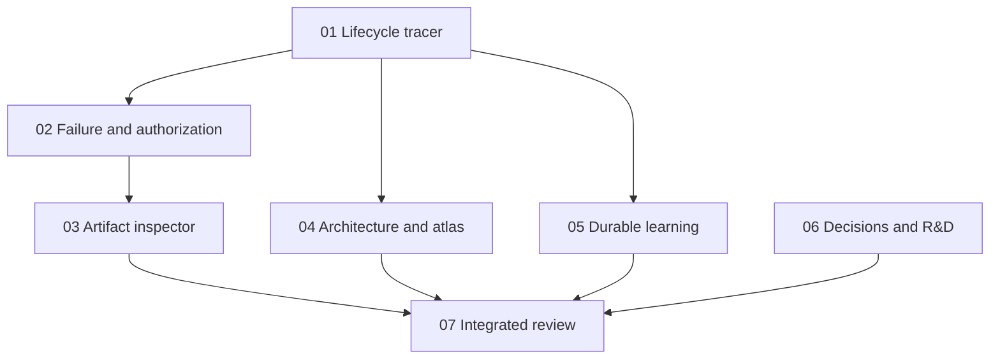

# Proposed ticket graph: The Agentic Operating System

Parent: `.planning/specs/2026-11-26-agentic-operating-system.md`

Proposed parent normative digest: `fbecdd0b0a48812e80e198a6cf5c77567911d8c8288fe5784056e12e64125aad`

The author delegated portfolio planning and ticket decomposition. These are repository-local proposed review contracts; graph approval and independent Steward certification have not been recorded. Digest binding does not confer approval.

## Dependency graph

| Ticket | Deliverable | Direct blockers | Carries |
|---|---|---|---|
| [01](issues/01-lifecycle-tracer.md) | Working lifecycle simulator and opening | None | R1, R2, C1, C2, C3, C4, C5 |
| [02](issues/02-readiness-failure-and-authorization.md) | Failure, revision and authorization scenarios | 01 | R3, R6, C1, C2, C3, C4, C5 |
| [03](issues/03-artifact-chain.md) | Contract, evidence and verification inspector | 02 | R4, C1, C2, C3, C4, C5 |
| [04](issues/04-architecture-and-atlas.md) | Layered architecture and seven-view atlas | 01 | R5, C1, C2, C3, C4, C5 |
| [05](issues/05-durable-learning.md) | Durable learning and fresh-session resumption | 01 | R7, C1, C2, C3, C4, C5 |
| [06](issues/06-product-judgment-and-rd.md) | Design decisions and R&D leadership bridge | None | R8, C1, C2, C3, C4, C5 |
| [07](issues/07-integrated-review.md) | Integrated capstone and review evidence | 03, 04, 05, 06 | R1, R2, R3, R4, R5, R6, R7, R8, C1, C2, C3, C4, C5 |

01 is a working vertical tracer, not a scaffold. 02 extends its transition model and 03 inspects those revision/evidence/authorization states. 04 and 05 use the page and scenario foundation. 06 can progress independently with authorized evidence and may be blocked for historical claims if evidence is unavailable. 07 reconciles links, checks the integrated experience and verifies the original contract. There are no redundant direct blocker edges.

## Review and integration

Use the agent-home graph review and independent Steward certification on the current revision before dispatch. The existing atlas branch is the base; incorporate the current shared work-story changes without dropping atlas or sibling work. These files are proposed repository-local Markdown contracts consistent with the adjacent portfolio packages, not activated GitHub Issues. Do not publish, deploy or merge to the deployment branch without separate authority.
