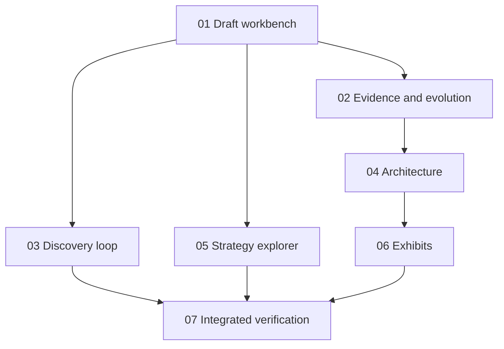

# Proposed ticket graph: AI-Guided Small-Molecule Discovery

**Decision requested:** approve or revise the seven proposed vertical slices, their granularity and blocking edges, before tracker publication or execution.

Parent: `.planning/specs/2026-11-26-ai-guided-discovery.md` (branch `spec/ai-guided-small-molecule-discovery`)

Proposed parent normative digest: `86a64234f02750aa67f29570bde20304b3c56d0624a934d98bbeea795d31aabf`

Parent and graph approval, independent Steward certification and tracker configuration are pending. No publication or execution is authorized by this package. The parent digest is revision binding, not proof of approval.

## Dependency graph

Ticket 06 needs the evidence ledger and architecture outputs; 02 is inherited transitively through 04, so no redundant direct edge is added.

## Proposed slices

| Ticket | Deliverable | Direct blockers | Carries |
|---|---|---|---|
| [01](issues/01-draft-workbench.md) | Deliver a draft case-study shell with a working nomination scenario | None | R1, R3, R8, C1, C2, C3, C4, C5 |
| [02](issues/02-evidence-evolution-contribution.md) | Ground the contribution and product-evolution narrative | 01 | R1, R4, C1, C2, C3, C4, C5 |
| [03](issues/03-scientific-loop-visual.md) | Make the discovery problem and learning loop visible | 01 | R1, R2, C1, C3, C4, C5 |
| [04](issues/04-architecture-handoffs.md) | Expose the scientific workflow architecture and handoffs | 02 | R5, C1, C2, C3, C4, C5 |
| [05](issues/05-strategy-explorer.md) | Demonstrate conditional scientific strategy choices | 01 | R6, C1, C2, C3, C4, C5 |
| [06](issues/06-inspectable-work-products.md) | Curate work-product exhibits and reflection | 04 | R7, C1, C2, C3, C4, C5 |
| [07](issues/07-integrated-interview-review.md) | Verify the assembled interview case study | 03, 05, 06 | R1, R2, R3, R4, R5, R6, R7, R8, C1, C2, C3, C4, C5 |

## Coverage and review

- 01 establishes a real end-to-end demo and draft integration surface.
- 02, 03 and 05 are independent after 01. 04 requires the approved evidence abstractions from 02; 06 consumes the architecture and evidence outputs. 07 waits only on the three terminal branches.
- Each ticket carries parent requirement/constraint IDs and evidence seams. Integrated verification rechecks all eight requirements and five constraints.
- The historical claims lane is gated on the required private evidence/voice corpus. Illustrative demo work does not depend on access to that corpus.
- Structural checks: seven proposed contracts, matching local Carries IDs, testing seams for each ID, full parent R/C coverage, acyclic graph, no redundant direct blockers. Independent Steward LINT has not run.

## Required review

Approve or request changes to the graph and contract drafts. The portfolio repository has no discovered issue-tracker configuration; confirm the preferred tracker before publishing. The proposed parent is not approved or certified yet. Run the agent-home human-review graph/gate and independently certify the approved contracts before execution.
