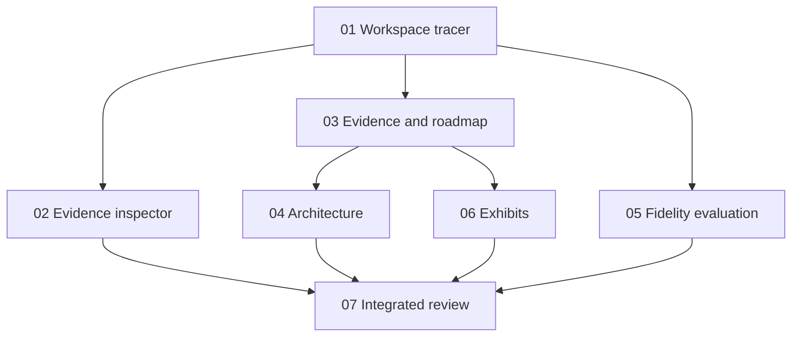

# Proposed ticket graph: Governed AI for Expert Work

Parent: `.planning/specs/2026-11-26-governed-advisor.md`

Proposed parent normative digest: `63e3162e8c8855dd02fb055864ce6de6482b8f256768b470bec2446ccc27ae7c`

Planning and ticket decomposition were delegated by the author as part of the portfolio case-study sequence. This package is saved for review; the required human-review gate and independent Steward certification are not recorded as passed. The digest binds the proposed revision and is not evidence of approval. No implementation or deployment is authorized by these files.

## Graph

| Ticket | Deliverable | Blocked by | Carries |
|---|---|---|---|
| [01](issues/01-workspace-tracer.md) | Working synthetic advisor workspace | None | R1, R2, R3, R5, C1, C2, C3, C4, C5 |
| [02](issues/02-evidence-and-trust-inspector.md) | Claim evidence inspector and trust boundary | 01 | R3, R5, C1, C2, C3, C4, C5 |
| [03](issues/03-evidence-and-roadmap.md) | Contribution and evidence-driven roadmap | 01 | R1, R7, C1, C2, C3, C4, C5 |
| [04](issues/04-governed-architecture.md) | Inspectable governed intelligence architecture | 03 | R4, C1, C2, C3, C4, C5 |
| [05](issues/05-fidelity-evaluation.md) | Interactive fidelity and grounding evaluation exhibit | 01 | R6, C1, C2, C3, C4, C5 |
| [06](issues/06-exhibits-and-reflection.md) | Inspectable decision work products and reflection | 03 | R8, C1, C2, C3, C4, C5 |
| [07](issues/07-integrated-review.md) | Integrated interview-ready draft and verification | 02, 04, 05, 06 | R1, R2, R3, R4, R5, R6, R7, R8, C1, C2, C3, C4, C5 |

01 establishes a complete interactive tracer rather than a horizontal scaffold. 02 and 05 use its scenario/interaction foundation. 03 establishes the approved historical narrative and private evidence mapping; 04 and 06 rely on its abstractions. 07 reconciles final cross-exhibit navigation and verifies the assembled experience. The graph covers all parent R/C IDs with no cycles or redundant direct edges.

## Review and integration

Review the parent and this exact graph with agent-home human-review. Independently certify the parent and tickets at their current digests before dispatch. Use repository-local Markdown as the proposed ticket source, consistent with the adjacent portfolio spec workflow; no active tracker configuration is assumed. Preserve the base implementation revision and reconcile sibling branch work before implementation; do not overwrite existing case studies.

The historical narrative lane may be blocked by inaccessible evidence or disclosure; synthetic demo and evaluation design remain illustrative. Integrated completion requires the parent evidence matrix and a private review draft, not release.
